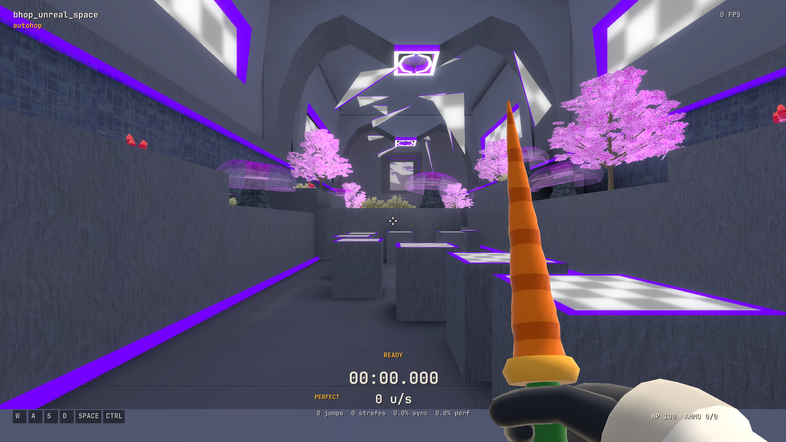

# Native 0.4.0 release notes (candidate)

This is a preparation document. Publication, platform package identities and
production admission evidence are recorded only after the exact candidates pass.

## Changes

- Physics 18 and the v0.0.28 canonical verifier, including material-defined
  ladders and visible black/white tool-material walls. Older replay physics
  versions keep their historical behavior.

- Shared web profile statistics, activity, card editing, Loadout and Support flows
  in the native menu, with Back/Esc history and narrow-window layouts.
- Native chat entry, Unicode shaping, IME, grapheme editing and bidirectional
  caret movement; room scoreboard, leaderboard, commands and spectator controls.
- Window/fullscreen controls, F10 settings, presets/search, HUD placement,
  controller menu navigation, map caching and staged loading transitions.
- Original character, weapon and inspect animations; Runner selection; player
  glow, live Loadout previews and native onboarding reactions.
- Improved map visibility, water/fog behavior, start/end zones, known-WR finish
  feedback and color-blind zone/HUD/menu palettes.
- High-rate mouse input handling and diagnostics, including the Windows raw-input
  path. Physical 8 kHz and input-latency qualification remain separate.
- Replay vault, scrubbing, cinematic cameras, clip export and synchronized
  gameplay audio. Sound controls cover movement, impacts, weapons, UI, ambience,
  speed wind and an optional cached classic CS:S pack.
- Automatic PB/WR, speed, hop-streak and clean-longjump announcements with
  granular controls. Clean-LJ observation follows the original web tracker
  without changing canonical physics or replay bytes.
- Opt-in replay music from the shipped gameplay OST or custom pack, with song
  offset, level, looping and ducking. Export follows current volume/mute settings.
  The three bundled announcer recordings use attributed CC BY 4.0 sources.

## Validation and distribution

The final candidate must retain per-platform package reports, native/WASM parity
results, release-contract checks and an independent review of the exact source
and artifacts. macOS packages are ad-hoc signed unless stated otherwise; Windows
and Linux packages are unsigned. No notarization or Authenticode claim is implied.

Ranked scores require exact server admission of each packaged build, canonical
WASM, physics and timer rules. Release notes must state the observed admission
expiry and distinguish a live allowlist check from an actual human score upload.

Custom CSS, enhanced graphics and optional CS player skins are outside this release's
requested scope. Physical Windows/Linux and live account/multiplayer checks must
be reported separately from automated fixtures. Performance charts describe fixed
scene render throughput on one Mac, not general gameplay or input latency.

## Local v18 qualification (October 26)

The macOS build and all 48 CTests passed. Menu validation passed 194 tests with
1,629 assertions; public release-contract validation passed 68 tests. The Rust
bridge passed 27 tests and the targeted core suite passed 19, including the actual
synthetic ladder and unreal-space black-wall maps.

The release movement gate compared 47,832 native/WASM states with zero mismatches
or missing physics. It retains v16/v17 RNGFix contrasts, tests those fixtures at
v18, and adds a material-defined ladder with v17/v18 contrast. Deliberate native
v17→v16 and v18→v17 downgrades were rejected (3,479 and 320 mismatched states).
An offline native recording matched all 1,822 state/timer rows, shared BHR bytes,
heartbeat hashes and 19 checkpoints. The canonical v18 ranked verifier accepted
it and rejected a changed checkpoint; nothing was submitted to production.

Independent source review found no P0/P1/P2 issues in the v18 integration.
Cross-platform candidate builds and exact-package review remain pending.

Actual native OpenGL capture from the v18 build. This frame-limited smoke is
render evidence; its FPS counter is not a performance measurement.
