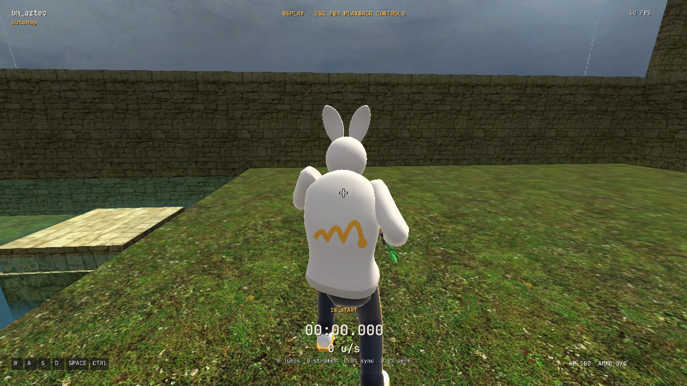
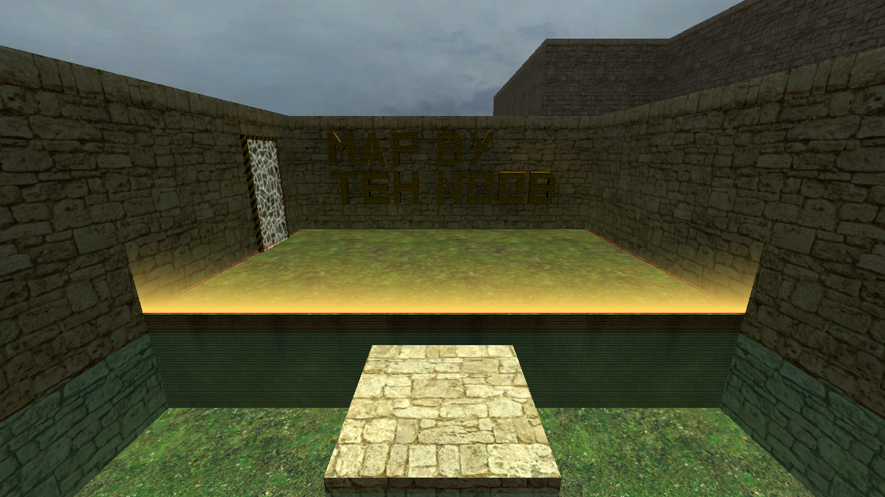
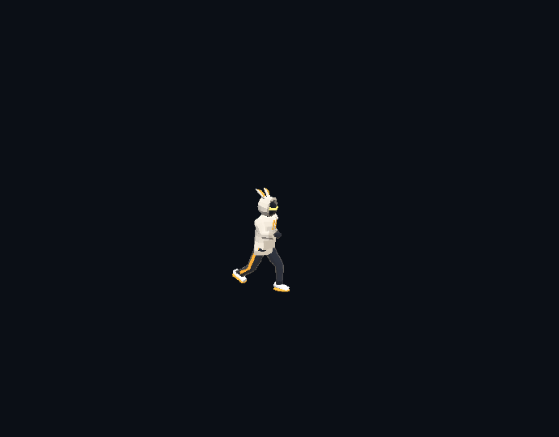
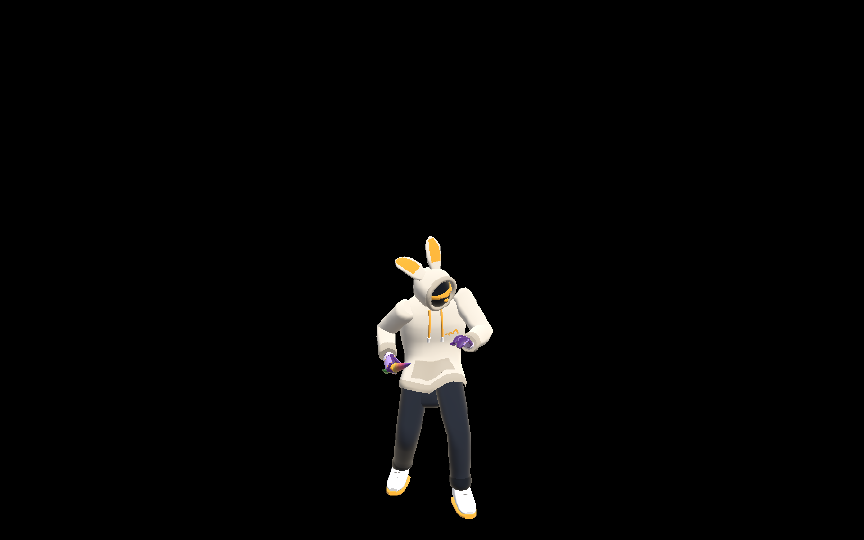
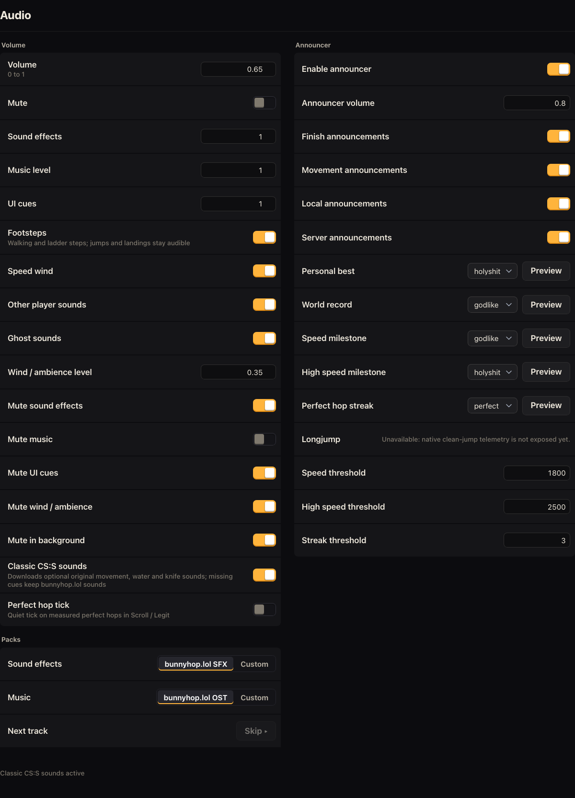

# Native audio and remaining feature gaps — 26 October 2026

This records the local native 0.4.0 follow-up. C++/SDL owns gameplay and export
sound; the WebView sends menu cues and verified account/room events. Custom CSS
and enhanced rendering remain outside scope. Nothing here publishes a release.

## Audio

- Shared live/offline stereo mixer with authored cue gains, bus routing, variation,
  debounce, concurrency limits and deterministic replay rendering.
- Movement, material footsteps, jumps/landings, ladders, water entry/exit/swimming,
  teleports, boosts, both speed-wind layers, weapon fire/handling/reload/silencer,
  material impacts, chat/room/menu cues and finish feedback.
- Classic CS:S movement/water/knife sounds are optional verified hosted downloads,
  cached locally. Missing cues use the default sound bank. The settings panel
  reports loading/active/fallback status. This is an optional pack, not a promise
  that every map hosts every original file.
- Wind can be disabled independently. Master/SFX/music/UI/ambience levels and
  mutes, background mute, footsteps, other players, ghosts and perfect-hop ticks
  are configurable. Disabling walking footsteps does not suppress jump/landing
  feedback. Existing custom sound/music folders remain supported.
- Announcer has an enable switch, local/server and finish/movement gates, volume,
  per-event line selection/previews, speed thresholds and perfect-hop streaks.
  Verified PB/WR events are deduplicated; WR takes priority over PB/movement.
  No announcement treats the provisional gold finish effect as a verified WR.
- Automatic longjump calls expose the core's existing `jumpstats_valid` observation
  through an additive C ABI and port the web LJ tracker. Clean standing jumps that
  land at the same height and cross the configured distance call the selected voice
  in live and replay audio. BH/fail reports, missing telemetry, timer clamps, seeks,
  mode changes, external mutations and interrupted flights cannot announce.
  Existing state layouts, physics, canonical snapshot bytes and replay data are unchanged.
  Targeted follow-up: 32 web-oracle cases / 2,872 ticks / 14 reports, real flat-jump
  and wall-hit regressions, live/replay observation equality across six replay
  versions, offline mixer positive/negative checks, and enabled-control browser tests.
  All 27 native bridge tests and the three focused CTests pass; no full app build
  was run for this follow-up.
- Release preparation replaced the three unresolved reference samples with
  explicitly CC BY 4.0 recordings: [Aimee Smith’s “Perfect”](https://opengameart.org/content/announcer-voice-pack-fighting-female) and [jkerman’s “Godlike”
  and “Holy shit”](https://freesound.org/people/jkerman/sounds/718360/). Author credits, source URLs, source/output hashes and trimming
  details are retained in `native/apps/native/assets/audio/manifest.json`; the
  package includes attribution and the full license. These are new recordings,
  not the UT/Quake samples used during the earlier local audit.

## Replay MP4 audio

“Include audio” defaults on. Export uses a separate offline mixer and advances
sound events on every simulation tick, independently of 30/60/120 FPS video.
Pre-roll preserves variation, movement history and tails at a trimmed start;
the end is exclusive. Sound preferences and cached custom/classic cues apply.
The mixer never opens an audio device or records the microphone/system output.

A bounded queue feeds RGB frames and stereo PCM to a worker. PCM is spooled to
disk, then FFmpeg muxes AAC with H.264. Final packet duration matches the selected
clip; cancellation/errors remove temporary files and restore replay state.
Music is opt-in from the currently selected native music pack: shipped gameplay
OST tracks (menu-only Drift is excluded) or custom `bgm` files. The song starts
at the chosen offset at the selected clip start, with optional looping and
ducking under gameplay/announcer cues. It uses the live native music bed level
(`0.55 × export multiplier × master × music channel`) and current mutes. Short
clip-edge fades are 0.3 s in / 0.5 s out, each limited to one quarter of the clip.
The decoded song is capped at 128 MiB; no clip-length audio buffer is allocated.
Simulation pre-roll advances ducking even before the selected clip start; music
only exports disable inaudible gameplay duck triggers. Missing, invalid or stale
track selections fail explicitly rather than substituting another song. Custom
track IDs include their filename extension to disambiguate equal stems.

Historical server PB/WR announcements are not reconstructed from BHR files.
Movement announcer events generated by the replay remain subject to current
settings. FFmpeg with libx264/AAC is required. No new music assets are introduced;
the existing shipped original OST and its manifest attribution are reused.
Custom songs come from the player's own library.

The final `--video-smoke` phase selects bundled Airstrafe at a 12 s offset and
records `audioScope`, `musicTrack`, `musicOffset` and `musicLevel` in `result.json`.
Its earlier cancellation/failure phases and tick/free-camera restoration checks
are preserved. Normal exports default to `music: "none"`.

The encode/decode regression covers audio on/off, 30/60/120 FPS, a one-frame 10 ms
clip, exact trim boundaries, events between rendered frames, mute gates,
cancellation, encoder failures and cleanup. Music tests also cover mono/stereo,
32 kHz resampling, independent channel content, song offset, loop/non-loop tails,
clip edge fades, exact gains, all relevant mutes, selected-pack/menu-track gates,
pre-roll finish ducking and music-only versus combined AAC at all three frame
rates. The source mix must match decoded AAC with waveform correlation above
0.9. In the original gameplay-only 1.13 s fixture, decoded audio
and video are both 1.130023 s with 24,917 source stereo frames and waveform
correlation 0.99985. Fixture videos are audio/encoder checks, not gameplay captures.

## Other changes

- Color-blind presets: Off, Red-green and Blue-yellow. Zones, native HUD semantic
  colors, trigger overlays and menu semantic CSS follow the selection.
- Start/reset curtains use the web's 250 ms transition; finish uses its 400 ms
  flare. The gold variant compares against a known WR through a read-only request
  fenced by map/style/track/attempt. Outward-facing curtains retain the floor
  outlines and use the web's squared alpha gradient.
- Chat preserves primary/secondary visual carets at bidirectional text boundaries
  through CoreText, DirectWrite or Pango. Grapheme editing and shaped selection
  coverage remain intact. Runtime verification here is macOS only.
- Third-person inspect gestures solve against the current animated pose, with
  chaining, held loops and cancellation; the web oracle covers 2,321 frames.
- Player and ghost model settings now select Bunny or the original Runner. The
  runner exports 5,953 vertices, 2,314 triangles and 20 bones; 1,200 frames match
  the original evaluator with maximum matrix error `3.82e-6`. Ghosts can inherit
  the player choice or override it. Loadout/onboarding retain Bunny. The original
  runner has no Bunny loadout or held weapon, matching web behavior.
- Onboarding uses the native preview renderer for the original acting timeline,
  form reactions and reduced-motion handling. Its name tag remains a simple DOM
  label rather than the full web nameplate decoration.

## Evidence and release limits

Final integrated macOS Release build passes. **46/46 CTests** and menu build,
typecheck, **191 UI tests / 1,610 assertions** pass. This includes the offline
audio mixer, encode/decode export, inspect/runner oracles, zone transitions and
text editing. Another **6 packaging identity tests / 61 assertions** pass.
The local build script now uses the same schema and canonical executable hash
as the package builder; a fresh full-client run accepts the generated manifest.
This verifies identity consistency, not production ranked-build admission.
Native-rendered screenshots below were inspected.

The full-client replay smoke exported 120 H.264 frames with stereo AAC; both
streams are exactly **2.000000 seconds**. Decoded audio is non-silent (peak 0.0950,
RMS 0.00370). Completion, cancellation and encoder failure restored the paused
replay at tick 37 and its free camera. Evidence is under
`native/artifacts/native-audio-gap-review/client-export/verification.json`.
A second full-client export with saved Runner settings verifies that UI preference
application reaches the actual gameplay renderer; it also passes restoration
checks, with matching two-second video/audio. Evidence is under
`native/artifacts/native-audio-gap-review/client-runner-export/`.

The inspect oracle now freezes wall-clock idle sway and procedural randomness
in export and reference generation: **2,321 frames, zero matrix error**, without
relaxing tolerance. Runner and preview smoke captures also verify selection,
menu isolation and framebuffer/viewport restoration. The floor-bone regression
still uploads identity once and makes 21 floor draws with no further uploads.

Optional CS player skins are not implemented. Physical Windows/Linux input, audio devices, system WebViews,
live multi-client/account/verified-score flows, signed update configuration and
release packaging still need their own qualification. No hardware latency claim
is established by offline sound or rendering tests.

## Captures

Actual C++ gameplay export frame:

Actual C++ zone curtain (known-WR gold finish):

Actual native renderer runner and onboarding captures:

Audio settings, browser fixture with mocked host state (not system-WebView qualification):

## Native 0.4.0 integration follow-up

The final announcement/music integration passes the macOS Release build,
**48/48 CTests**, menu build/typecheck, **192 UI tests / 1,621 assertions**,
**27 Rust bridge tests**, **17 physics-version tests**, **59 release-contract
tests** and **20 packaging tests** (three Linux-only ELF tests skipped on macOS).
The movement gate compares **31,440 native/WASM states with zero mismatches**;
the adversarial v17-to-v16 mutation is rejected across all four feature fixtures.

A full-client export with `game-airstrafe` at song offset 12 seconds produces
120 H.264 frames and stereo AAC with both streams exactly **2.000000 seconds**.
Decoded combined audio has RMS 0.04340 (gameplay-only reference: 0.00370).
Completion, cancellation and encoder failure restore tick 37 and the free camera.
The result records `audioScope: gameplay+music`. Evidence:
`native/artifacts/native-040-release-review/client-music-export/verification.json`.

These are local pre-candidate checks. Platform CI, exact artifact review and
production admission must be recorded against the actual release commit.
