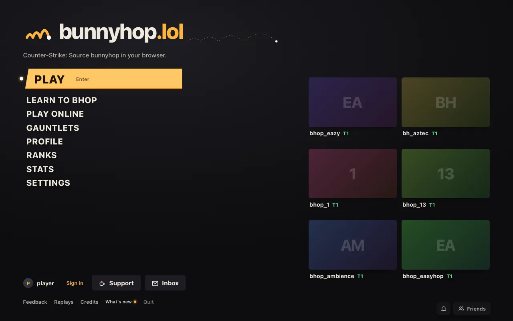
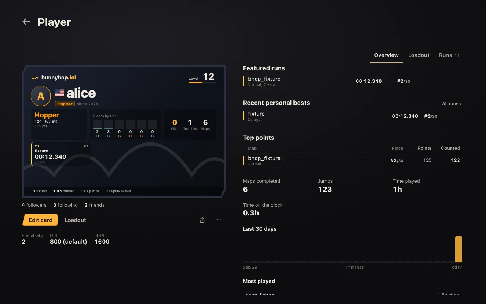
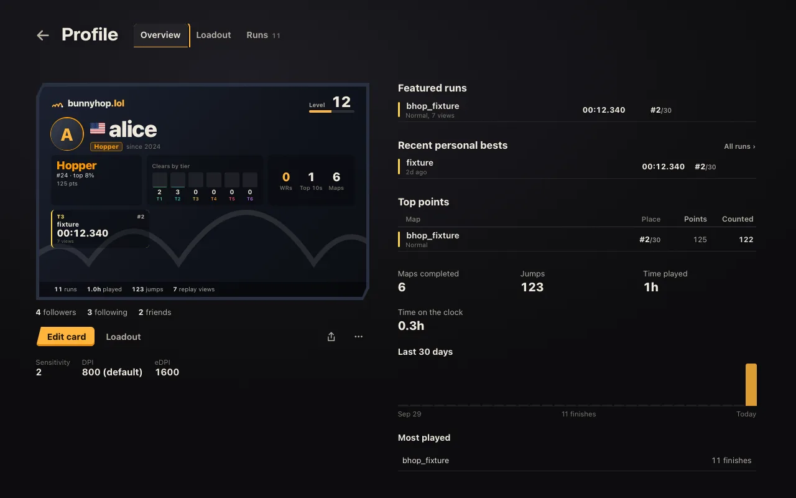
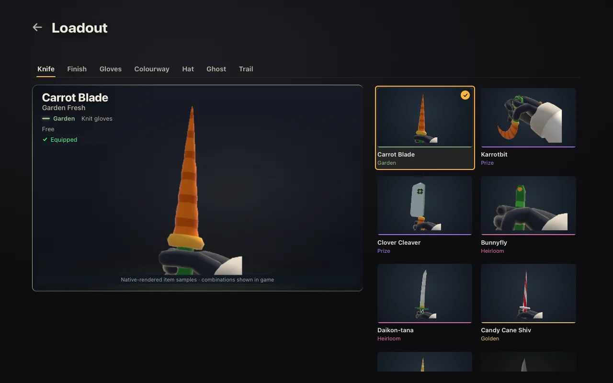
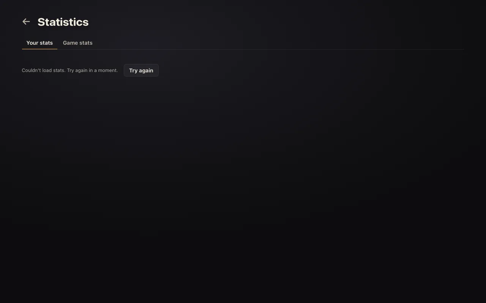
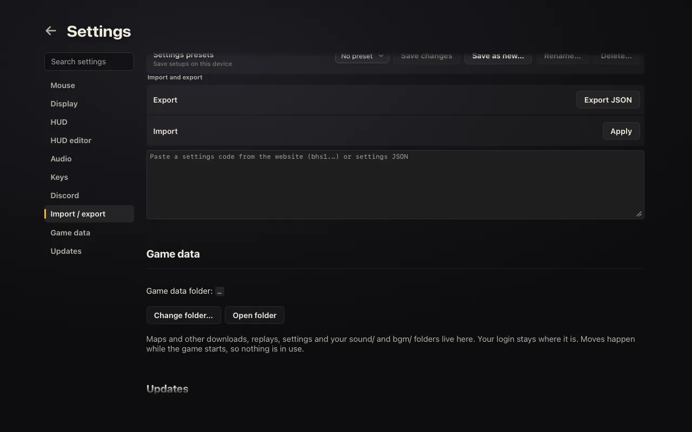
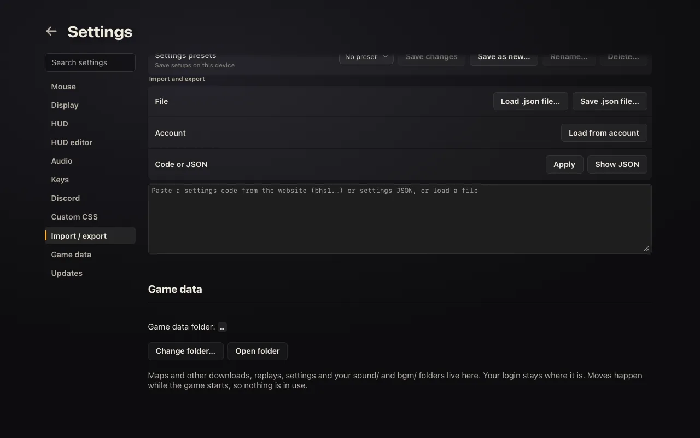
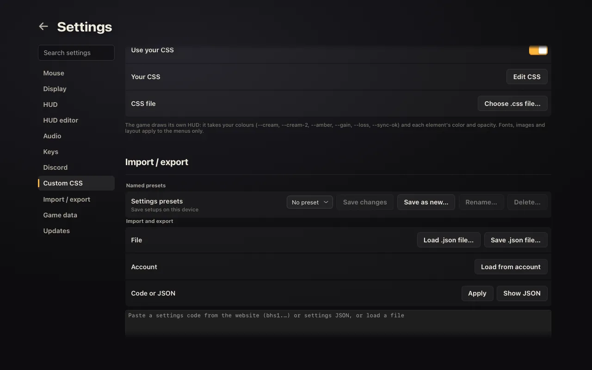

# Native menu vs. web UI, 28 October 2026

The native menu builds from the web UI vendored in `native/apps/web` (v0.0.28), plus native adapters in
`native/apps/native/ui`. This table compares it with the website (bunnyhop main, 26 Oct).

**Same**: the web's own code and markup. **Adapted**: a native version of the same feature. **Missing**: not in the
native menu. **Fixed**: missing or wrong before this change.

## Feature matrix

| Web | Native | Notes |
| --- | --- | --- |
| Home menu items (Play, Learn, Play online, Gauntlets, Continue, Profile, Ranks, Stats, Settings) | Same | |
| Home footer: Feedback, About, Privacy, Terms, Credits, What's new | Fixed | About, Privacy and Terms were missing. They open in the browser. Credits is a native screen. Replays and Quit are native-only. |
| Home "Desktop app" link | Adapted | Not shown: this is the desktop app. The website's link should name both apps; that's a website change. |
| Home tagline | Fixed | Said "in your browser". |
| Pause menu | Same | Every web entry, plus Replays and Checkpoints. |
| Maps browser, Ranks, Gauntlets, Servers | Same | |
| Rooms / chat screen | Adapted | Native room panel. In-game chat is drawn by the game (below). |
| Profile | Fixed | Titled "Player" with its tabs below the header. Now "Profile" with tabs in the header, as on the web. |
| Loadout | Fixed | Was its own "Loadout" screen. Now the profile's Loadout tab under "Profile"; signed out, that tab alone, as on the web. |
| Stats | Fixed | Was "Statistics" with tabs below the header. Now "Stats" with tabs in the header. |
| Support | Fixed | Title is "Support" with tabs in the header. Checkout opens in the browser. |
| Report player, Feedback, Inbox, Friends dock, Changelog | Same | |
| Settings | Adapted | Native settings screen with the native game's options. |
| Settings → Import / export | Fixed | Adds Load/Save `.json` file through the system dialogs and Load from account. Paste of `bhs1.` codes and JSON already worked. |
| Settings → Custom CSS | Fixed | Was missing. Same editor, `@import`, asset proxy, limits, rewrite and Ctrl+Shift+V. A chosen `.css` file is watched, as in the desktop app. |
| Settings saved with the account | Adapted | The native menu can load the account's settings. It doesn't upload them (see below). |
| Settings → Controls help page | Missing | P3. Settings → Keys lists every bind. |
| Graphics presets | Missing | The native renderer has its own Display settings. |
| Player glow hint | Fixed | Restores "…so you won't see it in game." (`ui/adapt-copy.ts`; the next web sync makes it a no-op). |
| Onboarding, gamepad navigation, HUD editor | Adapted | Native versions. |
| Replays | Adapted | Native replay library and playback. |
| Live HUD numbers (`--hud-speed` …), `#custom-art`, `#hud` fonts and images | Missing | The HUD is drawn by the game, not the page. See below. |

## Custom CSS and the native HUD

The menus take the whole stylesheet. The HUD is drawn by the game, so the menu resolves the parts the game can use
and sends them to it:

| CSS | Native HUD |
| --- | --- |
| `--cream`, `--cream-2`, `--amber` | HUD text, secondary text, accent |
| `--gain`, `--loss`, `--sync-ok` | Speed and gain colours, over the colour-blind palette |
| `#hud [data-el="..."] { color }` | Plain text colour of `speed`, `timer`, `split`, `stats`, `jumpStats`, `strafeTrainer`, `keys`, `graph`, `map`, `fps`, `ammo` |
| `#hud [data-el="..."] { opacity }` | Opacity of the same elements |
| `--hud-font`, sizes, backgrounds, borders, shadows, `::before`/`::after`, `#custom-art`, live numbers, `#rv`, `#crosshair` | Not supported. Crosshair is in Settings → HUD. |

## Settings with the account

The website saves the whole web settings document with the account (`/me/settings`, opt-in). The native menu can load
it into Import / export. It doesn't upload: native settings cover part of that document, and a push would overwrite
the rest with defaults. Uploading needs a native → web mapping that keeps the account's other values, or a separate
`native` section in the stored document. Both are API/web changes.

## Screenshots

WebKit (Playwright) at 1280×800, settled before capture. Before = v0.5.1 (`4ca38014`).

| Screen | Before | After |
| --- | --- | --- |
| Home |  |  |
| Profile |  |  |
| Loadout, signed out |  |  |
| Stats |  |  |
| Import / export |  |  |
| Custom CSS | — |  |
