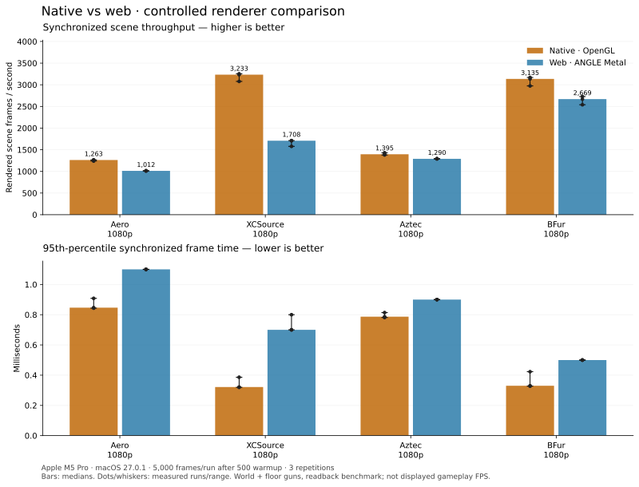

# Native and web renderer comparison

This compares the current native C++ OpenGL renderer with an optimized production
build of the web client's classic renderer. It is a **controlled scene-throughput
benchmark**, not displayed gameplay FPS, input latency, or Windows qualification.
The same map bytes, content manifests, eye position, yaw, pitch, Source FOV 90 and
pixel dimensions are supplied to both. Screenshots were checked for matching geometry
and framing. Material implementations are not identical: Aero water and XCSource
brightness differ.



Bars show the median of three independent runs. Dots show every run and whiskers
show the full range; they are not statistical confidence intervals. See
[results.json](results.json) for per-run summaries, map hashes, camera coordinates,
GPU details and build identifiers, and [samples.json.gz](samples.json.gz) for the
raw frame timings. The Python plotting script regenerates both PNG and SVG charts.

## Results

| Scene | Native frames/s | Web frames/s | Native p95 ms | Web p95 ms |
|---|---:|---:|---:|---:|
| Aero 1080p | 1,263 | 1,012 | 0.847 | 1.100 |
| XCSource 1080p | 3,233 | 1,708 | 0.321 | 0.700 |
| Aztec 1080p | 1,395 | 1,290 | 0.787 | 0.900 |
| BFur 1080p | 3,135 | 2,669 | 0.330 | 0.500 |

Native leads on these four fixed views after the correction below. This does not
establish a general native advantage across maps, hardware or actual gameplay.

## Aztec investigation and correction

**The first chart was not a fair floor-weapon comparison.** Our web harness hid
all scene children except the world, which also hid the separate floor-gun root.
Native still drew Aztec's ten floor weapons. The [original results](first-pass/README.md)
are preserved as superseded evidence, not a valid performance comparison.

Profiling also found a real native defect: every floor weapon redefined the same
3×1 identity bone texture using `glTexImage2D` every frame. Native now creates that
texture once and reuses it. Animated first-person guns and players retain their
own pose texture. This changes no mesh, material, pose or visibility settings.

| Native Aztec phase, diagnostic run | Before | After |
|---|---:|---:|
| Ten floor weapons, CPU/driver submission | 1.790 ms | 0.025 ms |
| World geometry submission | 0.019 ms | 0.018 ms |

These are means from 800-frame instrumented runs after 150 warmup frames, not GPU
timers or full-game FPS. The floor phase fell about 72×. Before/after framebuffer
bytes were identical (SHA-256 `f060e93c504965317e018d00c576b1ad216ee73e817349cda8072dc4802de9bc`).
The actual-GL regression checks one initial identity upload, zero uploads across
21 floor draws, correct draw-time texture selection, animated gun/player pose
uploads and restoration, and no GL errors. See [diagnostic evidence](aztec-investigation.json).

The corrected benchmark includes floor guns in both clients, explicitly chooses
Classic on both, and uses monotonic animation time through warmup and measurement.
The web harness refreshes brush/effect/floor state within the measured frame.
All four maps report LDR; the earlier Source/Classic default mismatch did **not**
explain Aztec. Phase profiling is disabled for the chart above. Native's inactive
profile counters in raw local output are uncollected values, not workload counts.

## Windows RTX 4090 / Electron comparison

The reported gameplay observation was roughly 4,000–10,000 FPS native versus
400–800 Electron, including `bhop_bfur`, with “Exceed monitor FPS” enabled.
Resolution and effective quality/FPS-limit settings are not yet recorded. BFur
has no floor weapons, so the Aztec fix does not directly explain that observation.

Source inspection identifies a separate pacing difference: web's uncapped loop
uses `GpuFence.mark()` after a frame (`fenceSync` + `flush`) and waits for
`GpuFence.idle()` before submitting the next one. Unlimited scheduling uses a
`MessageChannel`. Native's main loop does not use that same explicit per-frame
JavaScript/GPU-fence gate. The web settings default also retains a separate
1,000 FPS limit; enabling “Exceed monitor FPS” alone does not establish that the
limit is Unlimited. There is no hardcoded 400–800 FPS cap in the audited path.

These are plausible contributors, **not a measured Windows root cause**. The
controlled chart bypasses both gameplay loops and serializes both renderers with
`glFinish`/readback. It cannot reproduce Electron pacing, Windows drivers, a 4090,
HUD/viewmodel/simulation costs or the user's effective graphics configuration.
The smaller BFur gap here neither confirms nor contradicts the Windows result.

Audited web source: `apps/web/src/frame-loop.ts` (`GpuFence`, `FrameLoop`),
`apps/web/src/main.ts` (uncapped gate), `apps/web/src/ui/settings.ts` (`fpsLimit`)
from the web checkout identified by [results.json](results.json), plus
[`electron/policy.mjs`](../../electron/policy.mjs) in this repository (launch switches). Physical follow-up should record
resolution/render scale, graphics preset/water/AA, FPS limit, VSync, Electron GPU
backend and native driver, then replay the same route with real presentation.

## Conditions

- MacBook Pro (Mac17,9), Apple M5 Pro, 15 CPU cores, 16 GPU cores, 24 GB memory.
- macOS 27.0.1 (26A434), AC power. Other desktop activity and CPU/GPU clocks were
  not controlled; no claim of laboratory precision.
- Native: CMake Release build, Apple OpenGL driver. Web: optimized/minified Vite
  production bundle, headless Chromium, ANGLE Metal. The production build exposes
  the existing renderer and floor-weapon inspection hooks; it does not enable other DEV paths.
- Aero (`bhop_lol_aero`), XCSource (`bhop_xcsource`), Aztec (`bh_aztec`) and BFur (`bhop_bfur`), all
  at 1920×1080. No resolution scaling or Retina multiplication.
- 500 warmup frames, then 5,000 measured frames, three repetitions. Clients run
  sequentially; client order reverses in the second repetition. No builds or
  browser regression tests ran during the measured sequence.
- Fixed camera and stationary simulation. Visual animation time advances 1/60 s
  per frame. Classic/simple water settings with floor weapons enabled, with no player models, viewmodel,
  zones, debug triggers, HUD or menu in the measured scene.
- Each frame includes world rendering, `glFinish` and a one-pixel RGBA readback.
  Submission time is also recorded separately. Loading, screenshot encoding,
  simulation, input, network, window presentation and the browser compositor are
  excluded. Throughput is `1000 / mean synchronized frame milliseconds`.
- All BSP/content reads are local. The harness blocks external requests, writes
  and WebSockets. Published runs require no missing files/material candidates,
  JavaScript exceptions or GL errors. Optional stock model files absent from the
  native map folder are read from the local web cache only when the same manifest
  lists their exact SHA-256 and those bytes verify.

## Interpretation

These numbers measure how quickly each implementation completes this specific
world-render-and-readback workload. They are not a screen refresh rate, nor an
end-to-end playing benchmark. Readback/driver overhead is part of the result;
OpenGL and ANGLE Metal use different driver paths on this Mac. Different maps
can favor different implementations. Large run ranges should be treated as
uncertainty, not discarded. A short initial capture exposed variability, so the
corrected series uses the protocol above: 24 runs / 120,000 measured frames; no runs in that series are removed.

Before advertising a native FPS or latency benefit, repeat on physical Windows
hardware with the same replay, full HUD/viewmodel, real presentation, matched
quality and capped/uncapped modes. Test mouse delivery separately; this chart
cannot establish 8 kHz hardware support or input-to-display latency.

## Reproduce

Build the native client using the [native guide](../../native/apps/native/README.md).
The benchmark target is part of the native CMake build. A full web source checkout
with its dependencies and assets is needed; the native menu's web-source subset
is intentionally insufficient to build the web game.

```sh
cd native
cmake --build apps/native/build --target bunnyhop-native-render-benchmark
bun apps/native/tools/web-render-benchmark.ts --prepare --web-root /path/to/web-repo
```

Create `MAP-probe-spec.json` for each map in a working directory. `path` is the
local BSP and `contentRoot` its native `content/` folder (beside `manifest.json`).
Use one frame/one warmup for these camera probes only; they are not published timings.
Omitting `eye` and `yaw` lets the native probe report its spawn camera.

```json
{
  "map": "bhop_lol_aero",
  "path": "/path/to/bhop_lol_aero.bsp",
  "contentRoot": "/path/to/map-cache/content",
  "width": 1280,
  "height": 720,
  "frames": 1,
  "warmup": 1,
  "out": "/path/to/captures/bhop_lol_aero-probe.json"
}
```

```sh
apps/native/build/bunnyhop-native-render-benchmark /path/to/captures/bhop_lol_aero-probe-spec.json
# Repeat probes for bhop_xcsource, bh_aztec and bhop_bfur; inspect matching captures.
python3 apps/native/tools/compare-render-performance.py \
  --probe-dir /path/to/captures --web-root /path/to/web-repo \
  --maps bhop_lol_aero,bhop_xcsource,bh_aztec,bhop_bfur --resolutions 1080
uv run --with matplotlib python apps/native/tools/plot-render-performance.py \
  --input /path/to/captures --output ../docs/performance \
  --hardware-json ../docs/performance/hardware.json
```

The comparison driver defaults to 5,000 measured frames and 500 warmup frames.
Record the actual machine/OS/power and build metadata when running on a different
machine by supplying an updated `hardware.json`; the checked-in file describes this run.
The full local captures and screenshots are under `native/artifacts/native-web-perf-corrected/`.


## Verification for this change

Release native app build `bunnyhop-native/4f45a580302bd570f49a9254` passes;
39/39 CTests pass. The actual-GL floor-pose smoke passes with no GL errors.
An independent audit checked all 24 timing runs, matching scene inputs, sample
counts, shader warmup and zero web read/material/JavaScript/GL failures. No push,
merge or release was performed.
