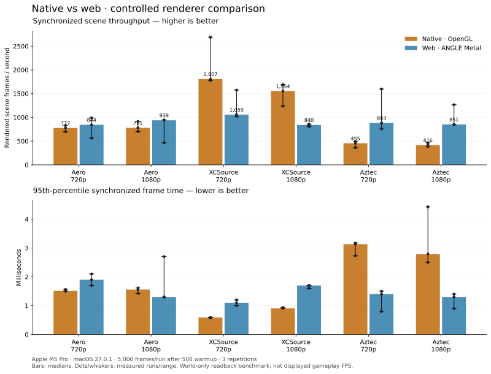

> **Superseded benchmark — do not use for performance claims.** This first pass hid floor guns on web while native rendered them (10 on Aztec). It also predates the native floor-pose upload fix and the monotonic warmup correction. See the [corrected report](../README.md). All three maps were LDR, so the mismatched Source/Classic defaults were not the cause of these results.

# Native and web renderer comparison

This compares the current native C++ OpenGL renderer with an optimized production
build of the web client's classic renderer. It is a **controlled scene-throughput
benchmark**, not displayed gameplay FPS, input latency, or Windows qualification.
The same map bytes, content manifests, eye position, yaw, pitch, Source FOV 90 and
pixel dimensions are supplied to both. Screenshots were checked for matching geometry
and framing. Material implementations are not identical: Aero water and XCSource
brightness differ.



Bars show the median of three independent runs. Dots show every run and whiskers
show the full range; they are not statistical confidence intervals. See
[results.json](results.json) for per-run summaries, map hashes, camera coordinates,
GPU details and build identifiers, and [samples.json.gz](samples.json.gz) for the
raw frame timings. The Python plotting script regenerates both PNG and SVG charts.

## Results

| Scene | Native frames/s | Web frames/s | Native p95 ms | Web p95 ms |
|---|---:|---:|---:|---:|
| Aero 720p | 777 | 844 | 1.515 | 1.900 |
| Aero 1080p | 781 | 939 | 1.556 | 1.300 |
| XCSource 720p | 1,807 | 1,059 | 0.592 | 1.100 |
| XCSource 1080p | 1,554 | 840 | 0.910 | 1.700 |
| Aztec 720p | 455 | 883 | 3.129 | 1.400 |
| Aztec 1080p | 416 | 851 | 2.790 | 1.300 |

At 1080p, native leads on XCSource in this workload; web leads on Aero and Aztec.
The substantial ranges remain visible in the chart. This supports investigating
map-specific rendering costs rather than claiming one client is universally faster.

## Conditions

- MacBook Pro (Mac17,9), Apple M5 Pro, 15 CPU cores, 16 GPU cores, 24 GB memory.
- macOS 27.0.1 (26A434), AC power. Other desktop activity and CPU/GPU clocks were
  not controlled; no claim of laboratory precision.
- Native: CMake Release build, Apple OpenGL driver. Web: optimized/minified Vite
  production bundle, headless Chromium, ANGLE Metal. The production build exposes
  only the existing renderer inspection hook; it does not enable other DEV paths.
- Aero (`bhop_lol_aero`), XCSource (`bhop_xcsource`) and Aztec (`bh_aztec`), each
  at 1280×720 and 1920×1080. No resolution scaling or Retina multiplication.
- 500 warmup frames, then 5,000 measured frames, three repetitions. Clients run
  sequentially; client order reverses in the second repetition. No builds or
  browser regression tests ran during the measured sequence.
- Fixed camera and stationary simulation. Visual animation time advances 1/60 s
  per frame. Classic/simple water settings, with no player models, viewmodel,
  zones, debug triggers, HUD or menu in the measured scene.
- Each frame includes world rendering, `glFinish` and a one-pixel RGBA readback.
  Submission time is also recorded separately. Loading, screenshot encoding,
  simulation, input, network, window presentation and the browser compositor are
  excluded. Throughput is `1000 / mean synchronized frame milliseconds`.
- All BSP/content reads are local. The harness blocks external requests, writes
  and WebSockets. Published runs require no missing files/material candidates,
  JavaScript exceptions or GL errors. Optional stock model files absent from the
  native map folder are read from the local web cache only when the same manifest
  lists their exact SHA-256 and those bytes verify.

## Interpretation

These numbers measure how quickly each implementation completes this specific
world-render-and-readback workload. They are not a screen refresh rate, nor an
end-to-end playing benchmark. Readback/driver overhead is part of the result;
OpenGL and ANGLE Metal use different driver paths on this Mac. Different maps
can favor different implementations. Large run ranges should be treated as
uncertainty, not discarded. A short initial capture exposed variability, so the
published series uses the longer protocol above; no runs in that series are removed.

Before advertising a native FPS or latency benefit, repeat on physical Windows
hardware with the same replay, full HUD/viewmodel, real presentation, matched
quality and capped/uncapped modes. Test mouse delivery separately; this chart
cannot establish 8 kHz hardware support or input-to-display latency.

## Reproduce

Build the native client using the [native guide](../../native/apps/native/README.md).
The benchmark target is part of the native CMake build. A full web source checkout
with its dependencies and assets is needed; the native menu's web-source subset
is intentionally insufficient to build the web game.

```sh
cd native
cmake --build apps/native/build --target bunnyhop-native-render-benchmark
bun apps/native/tools/web-render-benchmark.ts --prepare --web-root /path/to/web-repo
```

Create `MAP-probe-spec.json` for each map in a working directory. `path` is the
local BSP and `contentRoot` its native `content/` folder (beside `manifest.json`).
Use one frame/one warmup for these camera probes only; they are not published timings.
Omitting `eye` and `yaw` lets the native probe report its spawn camera.

```json
{
  "map": "bhop_lol_aero",
  "path": "/path/to/bhop_lol_aero.bsp",
  "contentRoot": "/path/to/map-cache/content",
  "width": 1280,
  "height": 720,
  "frames": 1,
  "warmup": 1,
  "out": "/path/to/captures/bhop_lol_aero-probe.json"
}
```

```sh
apps/native/build/bunnyhop-native-render-benchmark /path/to/captures/bhop_lol_aero-probe-spec.json
# Repeat probes for bhop_xcsource and bh_aztec, and inspect matching web captures.
python3 apps/native/tools/compare-render-performance.py \
  --probe-dir /path/to/captures --web-root /path/to/web-repo
uv run --with matplotlib python apps/native/tools/plot-render-performance.py \
  --input /path/to/captures --output ../docs/performance \
  --hardware-json ../docs/performance/hardware.json
```

The comparison driver defaults to 5,000 measured frames and 500 warmup frames.
Record the actual machine/OS/power and build metadata when running on a different
machine by supplying an updated `hardware.json`; the checked-in file describes this run.
The full local captures and screenshots are under `native/artifacts/native-web-perf-long/`.
