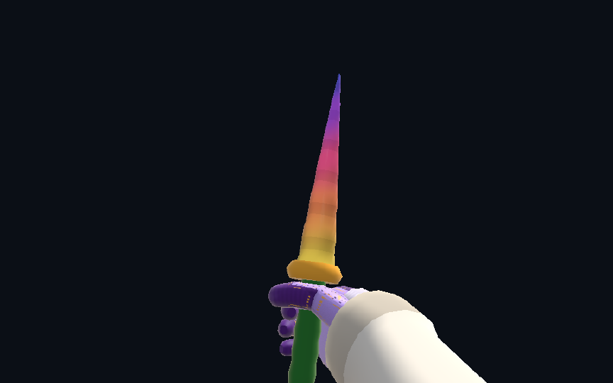
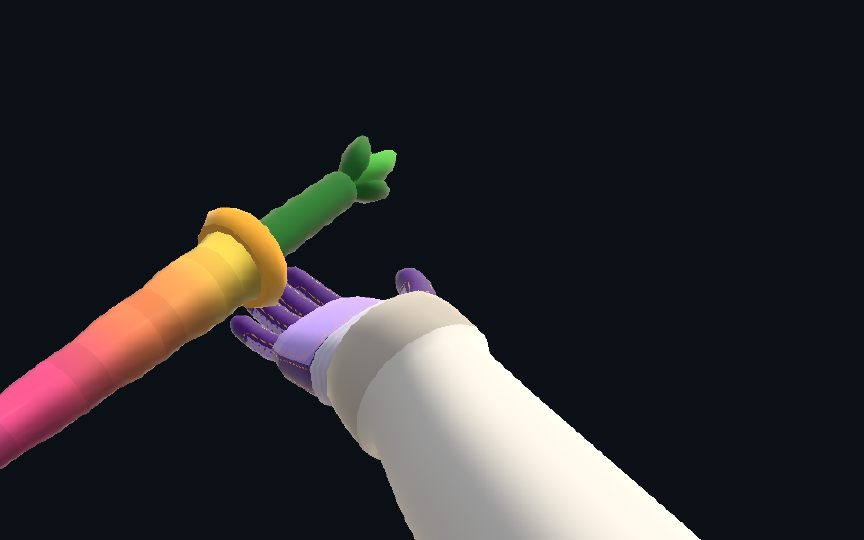

# Native client — preview

This fork's primary client is C++20/SDL3/OpenGL, linked to the shared Rust
simulation through a C ABI. Input, simulation ticks, rendering, timer rules,
command recording, replay encoding and heartbeat hashes run natively.

Web technology is used only for the map browser, account/sign-in controls,
leaderboards, settings and submission status. The menu bundle reuses those
website components and refuses imports of Three, the web game entry point or
the live simulation. macOS embeds WKWebView above the SDL view. Linux uses a
separate WebKitGTK menu window in the same application; the SDL game window
retains its native renderer and input. Windows uses WebView2 for menus and a
separate authentication view, with SDL still owning gameplay. There is no Electron dependency in this
client. The legacy Electron client remains at the repository root.

The home menu follows the website's layout and shared styles: navigation and
account controls on the left, six suggested maps on the right, and the featured
map behind them. Native OpenGL renders the map tour; macOS and Windows can
composite the menu over it, while GTK uses a bounded capture. Reduced-motion
preferences keep the camera still. The same map's artwork appears while loading
or if the native backdrop is unavailable, without a web gameplay renderer.

macOS ARM64 has been built and smoke-tested. Linux x64 and Windows x64 are
automated build targets, with execution and physical input validation reported
separately in the [release notes](https://github.com/2x74/bunnyhop-client/releases).
See the repository [release process](../../../docs/releases.md).

## Current compatibility

This branch prepares web v0.0.29 at `9cde9db9`, physics 18 and timer rules 2.
It pins a local build of the unpublished verifier. See the
[v29 integration notes](../../docs/v0.0.29-native-integration.md) for the remaining integration work.

## Build and play

Requirements: Bun, CMake 3.24+, Ninja, C++20 compiler, Rust/Cargo, SDL3, OpenGL,
libcurl and zlib development libraries, and ffmpeg for the build-time audio
conversion. macOS uses system Cocoa/WebKit frameworks.
Linux gameplay text additionally requires pkg-config and Pango/Cairo development files
(`libpango1.0-dev` on Debian/Ubuntu), even when menus are disabled.
Linux menus additionally require GTK3 and WebKitGTK 4.1 >= 2.40
(`libwebkit2gtk-4.1-dev` on Debian); without the menu libraries the CLI game remains available.
Install system fonts for Unicode text; Noto core/CJK/emoji packages provide broad fallback.
Windows text uses DirectWrite, Direct2D and WIC supplied by the Windows SDK/OS; their OS DLLs and installed system fonts are not redistributed.

From this repository’s `native/` directory:

```sh
bun install --frozen-lockfile
# Until the v29 WASM is published, build the pinned upstream source once:
bun tools/build-upstream-wasm.ts --upstream /path/to/bunnyhop
bun apps/native/packaging/sdl.ts   # optional: the SDL3 commit releases use
bun apps/native/build.ts
apps/native/build/bunnyhop-native
```

Releases build SDL3 from the commit in `packaging/sdl.json` on every platform.
`packaging/sdl.ts` builds it into `target/native-deps/sdl`, and `build.ts` uses it when present;
otherwise any installed SDL3 3.4 or newer works for development.

The build produces `target/native-menu/menu.html` and a release manifest bound
to the executable, menu and canonical WASM. `upstream-wasm.json` pins the source
commit, toolchain and WASM SHA-256. `bun run wasm` verifies the cached build;
a published pin downloads its public asset. Verified bytes are cached for offline
builds and ignored by Git. Rust is pinned through `rust-toolchain.toml` to the tested compiler.
A CMake-only rebuild or menu edit makes the previous manifest stale: the game
still works, but that binary cannot claim the previous release identity.

Pick a map from Play, or load one directly:

```sh
apps/native/build/bunnyhop-native --online-map bhop_eazy
apps/native/build/bunnyhop-native --map /path/to/bhop_eazy.bsp --no-menu
```

Online maps and hosted content come from bunnyhop.lol, are checked against their
SHA-256 hashes, and are cached in the native app's data directory. A local map
uses its adjacent `.zones.json`, when present. `--content-root DIR` supplies
loose Source files for local maps. Hosted maps use their downloaded content.

WASD moves, Space/wheel jumps, Ctrl ducks, E uses, R restarts, Escape opens the
menu, and F10 opens Display settings. Alt+Enter toggles borderless fullscreen.
SDL relative mouse motion drives the view; focus loss/menu
opening clears held input and pauses native simulation. All eight website styles
are available; bonuses use their canonical Normal settings. Sensitivity, separate
vertical sensitivity, FOV, VSync, FPS limit, volume, HUD/viewmodel visibility and
key/mouse bindings persist in the app's settings file.

High-rate mice use the same unscaled SDL relative-input path without an
application polling-rate cap. SDL's Windows backend drains buffered Raw Input;
the client preserves delivered counts in double accumulators and previews the
latest pending motion in the render camera. The fixed simulation tick rate is
unchanged. Mouse polling rate, rendered FPS and simulation rate are distinct.

Settings → Mouse → Input diagnostics overlay measures delivered motion events
per second, peak events per frame, SDL timestamp age and event-processing time.
Move continuously during play, then reopen Settings to inspect the last sample.
This is not a USB polling-rate detector or an end-to-end latency measurement.
The diagnostic is off by default and performs no per-event allocation or I/O.
Configure 1/2/4/8 kHz in the mouse vendor's software. Windows hardware acceptance
still needs comparison at those rates, with the same map and display settings;
test both uncapped/VSync-off and capped rendering for spikes, lost motion,
focus/Alt+Tab/restart behavior and button/wheel correctness. Do not infer an
8 kHz display or a measured latency advantage from input support alone.

## Replays and scores

Replays opens the local replay vault: completed and imported BHR files with
search, style filtering, sorting, dates and sizes. New completed runs also retain
local time, jumps, strafes and sync summaries. Device PBs are separate from account
records. Optional result screenshots can be enabled in Settings; summary/capture
retention is bounded and never automatically deletes replay files.

Playback opens with a clickable native timeline over the live scene. Drag to
scrub; Space pauses, Left/Right steps a frame, and Tab switches between the
cursor and camera control. The bar supplies start/end, ±5 seconds, speed and
camera controls; right-drag controls the chase/free view. Seeks preserve pause
state and free-camera position. The Replays menu also supports scrubbing,
ghosts, import/export and optional MP4 export with gameplay audio and music.

The native timer follows the shared versioned start/end, prehop, prespeed,
split and statistics rules. Native `.bhr` files use the existing compressed
replay format and are saved before upload in the native app data directory's
`replays/` folder. The filename is also logged. Normal play records in memory;
optional ABI evidence captures can write detailed JSONL for debugging.

Native code owns the four-second signed-heartbeat cadence and command hashes.
The menu uses its own bunnyhop.lol account session to carry those heartbeats and
upload a finished replay. It checks the live release policy before uploading.
The server still re-simulates every submission with the canonical WASM and
applies the existing integrity checks. No native verdict is trusted.

Only an exact, unexpired `ALLOWED_NATIVE_CLIENT_BUILDS` entry matching the
current server WASM/physics/timer rules enables ranked upload. A local, stale,
unknown or expired release keeps the replay on disk. Sign in through the menu
to use an existing account; it does not import another browser's cookies.

Mouse motion is accumulated at each SDL poll and prorated across simulation
ticks by elapsed time. Device event timestamps are not used. Rendering previews
pending motion without advancing the recording; focus/menu/restart transitions
discard pending input and reset the simulation clock baseline. Keyboard/button
state is read when SDL polls it.

Integer mouse counts retain counted-yaw telemetry. Fractional reports preserve
their precision through proration and recording. Playback supports BHR versions
1–10; recording uses the shared counted/uncounted formats, including fractional
manual-turn provenance when needed, loadout and inspect events. Turn binds at
210°/s preserve the server-supported provenance; other configured speeds keep the
attempt local-only with its BHR archive. Legit Scroll prohibits turn binds outside
practice. The native client
does not yet run a client-side WASM self-check. Server verification and signed
heartbeats remain enabled. Recordings are currently capped at 180,000 commands
(about 30 minutes); longer recordings cannot upload. Press R for a new recording
after a completed attempt. A pending server result may take longer than the
menu's 30-second status-poll window; the replay remains on disk. Completed
uploads survive starting another attempt (up to four in flight), but closing the
app does not persist heartbeat tokens or an automatic retry job. Changing the
confirmed account ID blocks the old attempt from further beats/upload; restart
after signing in or switching accounts. Same-account profile refreshes preserve
the attempt. An unavailable account check keeps the attempt local.

The replay library can watch, seek, pause, change playback speed, race a ghost,
import and export BHR files. Delete moves a replay into the local trash folder.
Leaderboard Watch/Race downloads the existing replay into this native pipeline.
Seeking and initial ghost preparation currently run synchronously; very long
replays can briefly stall the UI.

## Unsigned test releases

Preview builds are distributed from
[2x74/bunnyhop-client Releases](https://github.com/2x74/bunnyhop-client/releases)
under an unsigned preview policy. macOS bundles are
ad-hoc sealed (`codesign --sign -`), without Developer ID or notarization.
Windows packages are unsigned unless signing is explicitly configured.
Signing credentials are not a prerequisite for the default package command:

```sh
bun run package --version 0.4.0
bun apps/native/packaging/release-check.ts \
  --package target/native-packages/bunnyhop-native-0.3.4-darwin-arm64
```

Use the actual stage path printed by the packager for `--package`. It produces a
platform archive, an unpacked application, dependency notices and a JSON report
containing the archive SHA-256 and native build identity. The app includes its
menu, native presentation assets and runtime libraries. Bun, Cargo and the
source checkout are build dependencies, not player prerequisites. Optional MP4
export requires a local FFmpeg installation with libx264; normal play does not.

macOS package identity normalizes only signature metadata before hashing, so
ad-hoc sealing does not invalidate the embedded release identity. An exact
packaged build still needs the normal server allowlist entry for ranked upload.
Unsigned releases retain the platform's usual first-launch prompts.

Settings → Updates checks for signed releases and downloads verified packages
when the build has a configured manifest URL and trusted release public key.
The default key list is empty, so checking and downloading remain disabled.
Installation is manual: the client never replaces or executes itself. Manual
unsigned distribution does not require those keys. See [packaging](packaging/).

## Checks

```sh
ctest --test-dir apps/native/build --output-on-failure
cargo test -p bunnyhop-native-bridge
bun test apps/native/ui apps/native/packaging
bun apps/native/src/tutorial_oracle.ts /tmp/native-tutorial-oracle.json
apps/native/build/bunnyhop-native-tutorial-tests /tmp/native-tutorial-oracle.json
apps/native/build/bunnyhop-native-menu-backdrop-smoke \
  --map /path/to/bhop_eazy.bsp --out /tmp/bunnyhop-native-backdrop.png
apps/native/build/bunnyhop-native --menu-home-smoke /tmp/bunnyhop-native-home
apps/native/build/bunnyhop-native --online-map bhop_eazy --hidden \
  --menu-smoke /tmp/bunnyhop-native-menu
```

The app-owned smoke reads the live account API, checks the menu origin and zero
WebGL attempts, loads the native map, and captures menu/native-game screenshots.
It never records or submits a run. A render-only test needs no web view:

```sh
apps/native/build/bunnyhop-native --map /path/to/bhop_eazy.bsp \
  --hidden --frames 30 --screenshot /tmp/native.ppm
```

Native recorder verification against the canonical WASM uses an offline fixture:

```sh
bun crates/native-bridge/tools/record-proof.ts \
  --map /path/to/map.bsp --replay /path/to/route.bhr \
  --output target/native-record-proof/new-run
```

This compares every native state and timer/stat row, native replay bytes against
the shared encoder, heartbeat hashes and checkpoints. It invokes the shared
ranked verifier and verifies rejection of a changed checkpoint. It never posts
fixture runs to the live server. Scripted fixtures are not human input and may
correctly trigger the separate integrity analyzer.

Linux checks can run in Docker with `apps/native/tools/verify-linux.sh`;
`WITH_CLIENT=1` includes SDL/OpenGL under Xvfb/Mesa. Headless/Xvfb tests do not
establish physical mouse latency or performance on a real Wayland desktop.

## Current scope and remaining parity

Native rendering now includes Source skies/3D skies, displacement blends, detail
and normal maps, water/glass/fog, static and moving props, original hands/weapons,
knife inspections, cosmetics and remote-player models. Geometry and animation
assets are exported from the original project during the build; there is no web
game renderer in the shipped menu. HUD, crosshair, movement/weapon audio, replay
playback and ghost rendering run natively.

Web menus reuse the account API, map browser, leaderboards, friends/DMs,
notifications, ranks/stats, cosmetics and room transport. Rooms relay poses to
native interpolation/rendering and support chat, voting and scheduled map
changes. Tutorial goals and coaching use a native port compared against the
original web implementation. Practice checkpoints/noclip, sticky practice state,
the Practice label and 50–175% HUD scaling are implemented in the native host.
Gauntlets and player-report forms reuse the web UI. Main menu leaves the map,
and the home backdrop can replay a PB on a separate native context or tour a map.
All eleven production OST tracks are bundled, with native pause/previous/next
controls, crossfades, ducking and menu-track exclusion during gameplay.

Profiles reuse the current web card, editor, points/activity statistics, run
lists, social controls and full Loadout tab. Native activity updates local map,
jump and attempt history and reports active playtime through the account API;
unsent playtime is bounded and persisted for its owning account. Support reuses
the web one-time checkout and gifting flows, with checkout opened in the system
browser. Account controls include rename, avatar, linked identities and sign-out.
Account mutations and delayed responses are fenced against account changes.

Gameplay additions include scrolling chat with name/badge/rank decorations,
the complete paged weapon picker, sniper zoom, trails for all four ghost slots,
and bounded next-map cache prefetch during gauntlet playback.

Loadout thumbnails are exported from the original authored models. The live menu
preview renders combined knife/finish/gloves and characters through an independent
native OpenGL renderer: drag or use arrow keys to turn, switch to close-up, and
play or hold the original inspect animations. Static thumbnails remain available
when the native preview host is unavailable. Native players
use the web's hosted animation state machine, locomotion/aim/fire blending,
animated accessories and glow. Gameplay chat supports shaped Unicode, grapheme
editing, selection, IME and clickable profile/map/replay links. Replay cameras
use the web's cinematic planning algorithms; local MP4 export supports clip
trimming, resolution, orientation, frame rate, camera, HUD, gameplay audio and music.
Audio follows every simulation tick and current sound preferences, including
cached classic/custom cues. Music is opt-in: select a gameplay OST track or a song
from the current custom `bgm` pack, then choose its offset at the clip start,
level multiplier, looping and ducking. Music preserves stereo, uses short edge
fades and follows master/music levels and mutes; gameplay audio can be disabled
independently. The offline mixer opens no SDL device and captures no microphone
or system audio. Historical server PB/WR announcements are not reconstructed.
The existing `--video-smoke <directory>` fixture explicitly selects bundled
Airstrafe at a 12-second song offset for its final export, after testing cancel
and encoder-error restoration; `result.json` records the music and audio scope.
Normal user exports continue to default to no music.
Wind, ambience, movement sounds and announcer events have independent controls.

Display settings include windowed, borderless and fullscreen modes, always on
top, saved window bounds, centering, maximize/restore and optional minimization
on fullscreen focus loss. Map downloads persist in the application data cache:
verified content is reused, and complete cached maps remain playable offline.
Loading shows stages, file/byte progress, cancellation and retry. The Room panel
reuses the shared web scoreboard and map leaderboard.

Player and ghost model settings select Bunny or the original Runner. Loadout and
onboarding previews retain Bunny. Original runner locomotion, live third-person
inspect composition, native onboarding acting and dual-affinity bidirectional
chat editing are implemented. Color-blind palettes cover zones, HUD and menu;
start/end curtains use the web transition timing and known-WR gold finish effect.

Automatic clean-longjump announcements use the web clean-tick observation and
tracker in live play and replay audio, with configurable distance and voice.
This is not a claim of complete website parity. Optional CS player skins remain
unavailable. Signed updates need operator configuration. Announcer recordings use attributed CC BY 4.0 assets. See [the audio/presentation follow-up](../../../docs/native-audio-parity-2026-10-26.md)
and [the parity history](../../../docs/native-parity-2026-10-26.md) for evidence
and release limits.

Windows execution and a human native sign-in/finish/verified-score flow need
end-to-end confirmation. The other developer owns physical Linux input/performance
testing; headless Linux results cannot establish Wayland mouse behavior.
No FPS or latency improvement is established by correctness smoke tests.

The external movengine project was reviewed as a native input/BSP-rendering reference; this
prototype does not copy its GPL-3.0 code. Preserve repository and vendored
Source-related notices. The vendored JSON header is nlohmann/json 3.12.0 under
its included MIT license.

An integration test in the separately maintained server project also submitted
an untouched native-recorded BHR to an isolated API/WASM verifier. Admission,
native heartbeat hashes and altered-checkpoint rejection passed. That test used
local database/storage bindings and did not upload a fixture to production.
Server implementation and deployment configuration are deliberately absent
from this client repository.

### Menu settings and navigation

Settings includes up to 30 named, device-local presets with create, save, apply,
rename and delete controls. Switching away from modified preset settings asks
before replacing them. Search accepts multiple terms and common aliases, with
clickable spelling suggestions. HUD layout has a dedicated placement canvas:
drag a label, or use arrow keys (Shift for fine adjustments), to save native
percentage anchors. Numeric position, size and visibility controls remain available.
The HUD-editor bind opens this canvas directly.

The first-visit intro covers name, free outfit colour and sensitivity, then offers
a map or tutorial. It can be skipped or replayed from Account. Standard controllers
navigate menus through SDL on every native platform, with browser Gamepad API
fallback: stick/D-pad moves focus, A activates, B goes back/dismisses dialogs,
shoulder buttons change tabs, and left/right adjusts sliders. This is menu
navigation, not a new gameplay controller scheme. SDL virtual-device tests verify
mapping, releases, focus loss and hotplug; physical controller testing is still needed.

Custom CSS is intentionally outside the native menu scope. See the
[renderer performance report](../../../docs/performance/README.md) for the matched
native/web scene benchmark, its chart and reproducible commands.

Native preview renderer captures (combined cosmetics and inspect):





Menu UI captures with mocked host/account state: [HUD editor](../../../docs/images/native-hud-editor-fixture.png) and [first-visit intro](../../../docs/images/native-onboarding-fixture.png). These are browser fixture captures, not physical Windows/WebView2 qualification.
