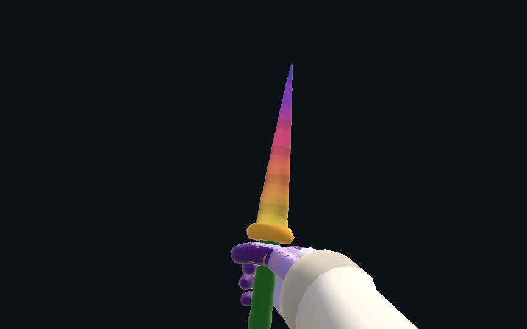

# Native client

The game runs in C++20 with SDL3 and OpenGL, linked to the shared Rust simulation through a C ABI. Input,
simulation ticks, rendering, timer rules, replay recording and heartbeat hashes all run natively.

Menus are the website's own UI in an embedded web view: WKWebView on macOS, WebKitGTK on Linux (a separate menu
window) and WebView2 on Windows. The menu bundle refuses the web game entry point, Three and the live simulation
(`build-menu.ts`, `menu-boundary.ts`). There is no Electron dependency; the old Electron client lives at the
repository root.
On Windows, the menu shows a still of the map behind it.

The vendored game sources come from web `release-0.0.40` at `5dd8e85f`, physics 28, timer rules 5. Historical
physics 1–27 remain available for replays. Physics 28 changes only Auto-strafe (the key from this command's yaw to the
next, the sim's view one tick behind the mouse: `crates/native-bridge/src/styles.rs`). The exact source and verifier hashes live in `upstream-manifest.json`
and `upstream-wasm.json`.

## Build and play

You need Bun, CMake 3.24+, Ninja, a C++20 compiler, Rust/Cargo, OpenGL, libcurl and zlib development libraries,
and ffmpeg (build-time audio conversion). Linux also needs pkg-config and Pango/Cairo (`libpango1.0-dev`), and
for menus GTK3 and WebKitGTK 4.1 >= 2.40 (`libwebkit2gtk-4.1-dev`). Windows needs the WebView2 runtime. Install
system fonts for Unicode text; the Noto packages cover most scripts.

From `native/`:

```sh
bun install --frozen-lockfile
bun apps/native/packaging/sdl.ts   # optional: the SDL3 commit releases use
bun apps/native/build.ts
apps/native/build/bunnyhop-native
```

Releases build SDL3 from the commit in `packaging/sdl.json` on every platform. `packaging/sdl.ts` builds it into
`target/native-deps/sdl`, and `build.ts` uses it when it's there; otherwise any installed SDL3 3.4 works for
development.

The build writes `target/native-menu/menu.html` and a release manifest bound to the executable, menu and WASM
verifier. `upstream-wasm.json` pins the verifier's source commit, toolchain and SHA-256. Rebuilding only the C++ or
the menu makes that manifest stale: the game still runs, but the binary no longer matches a released identity.

Pick a map from Play, or load one directly:

```sh
apps/native/build/bunnyhop-native --online-map bhop_eazy
apps/native/build/bunnyhop-native --map /path/to/bhop_eazy.bsp --no-menu
```

Hosted maps and content are checked against their SHA-256 and cached in the app's data folder, so cached maps play
offline. A local map uses its `.zones.json` when there is one; `--content-root DIR` adds loose Source files.

Default keys match the website: WASD, Space or wheel to jump, Ctrl to duck, E to use, R to restart, T for third
person, Escape for the menu. Alt+Enter toggles fullscreen. New installs start with VSync off and a 1000 FPS limit.

## Input

Each mouse report and key press counts in the tick it happened in, by its SDL event time, the same rule as the
website's timed input. Frame rate no longer decides which tick a strafe or A/D switch lands in, and the camera
still shows new motion at once. `--legacy-input` restores per-frame input for comparison. While you play, Windows
reads the keyboard through raw input.

Settings → Mouse → Show input stats overlays delivered reports per second, peak reports per frame, event age and
frame time per phase, and flags stalls over 50 ms. It also names the backend and reports motion timestamp jitter.
These measure delivered motion, including SDL timestamp estimates, rather than the USB polling rate.

Keys → Release W on jump works as on the website: a jump taken holding W lets go of forward until you land or press W
again. It's off by default, not available in Legit Scroll, W-Only, Sideways or Half-Sideways, and marked in the replay.

Keys → Movement → Landfix defaults on. Use `!landfix`, `!landfix on|off` or `cl_landfix 0|1` to change it, including
during a run. `bind k "say !landfix"` works in solo and rooms and answers privately. The choice is saved with your
settings; replays keep each tick's recorded choice.

Mouse → Advanced → Native input selects Auto, SDL or experimental Raw. Auto keeps SDL. Raw reads relative HID
counts with device timestamps on macOS (requires Input Monitoring) or evdev packets with monotonic kernel times on
Linux (requires access to the mouse device nodes). Buttons and keys keep SDL. Windows keeps SDL's raw-input thread;
its packet timestamps are estimates spread across each read batch. Missing permission, a disconnected device or a
raw queue overrun returns to SDL. After changing permission or reconnecting on Linux, select SDL then Raw to retry.
Check sensitivity with a physical mouse before using Raw; it has not completed target-OS hardware validation.

## Display

- Settings → Display → Fullscreen picks the monitor, resolution and refresh rate exclusive fullscreen switches to,
  so 4:3 (1280×960, 1024×768, 1440×1080) and 16:10 modes work. A new mode shows at once and goes back after ten
  seconds unless you press Enter. A resolution of another shape than the monitor asks Windows for Stretched or Black
  bars; drivers set to override games decide themselves. On Windows, fullscreen at the desktop's own mode changes
  no display mode, so opening the menu doesn't blank the monitor.
- A borderless or fullscreen switch must present its first frames (`src/display_check.hpp`). One the system refuses,
  or whose swaps stall, goes back to windowed and saves it. A switch the game never came back from leaves
  `display-check.json` in the data folder, and the next launch starts windowed. `--windowed` does the same by hand.
- Graphics → Aspect ratio gives the same picture in borderless without a mode change. With black bars the HUD and
  crosshair stay inside the picture. Mouse turning is counts × sensitivity × 0.022° in every mode.
- Windows: Display → Low latency mode presents through DXGI (flip model, tearing, VRR) and uses NVIDIA Reflex
  (with Boost and the latency analyzer's flash) or AMD Anti-Lag 2 when the card has them. It is offered only when the
  driver shares OpenGL frames with Direct3D, and any failure falls back to the OpenGL swap with a notice.
- While you play, Windows also gets a 1 ms timer, no power throttling and the "Games" scheduling class; menus and
  other apps get them back.
- A finished run records your view (shape, fit, FOV) with its diagnostics, so replays can show "4:3 stretched".

## Weapons

- A weapon switch lowers the old weapon out of view over 0.15 s while the new one comes up. The core still switches
  on its tick, so equip and fire timing are unchanged.
- Gun recoil builds up under rapid fire and through the Glock's burst, and rocks side to side from shot to shot. An
  empty gun twitches when it clicks. Reloads, inspects and the suppressor blend in and out instead of cutting.
- The hands move like the website's: CS:S bob, lag and strafe tilt, a landing dip, a short settle after a really hard
  fall, and an idle in the wrist and fingers. Bob now defaults to 50%; a saved Bob of exactly 100% moves to 50% once.
- Settings → Viewmodel → Inspect: Quiet starts with a short blade check that only you see. Press again for the knife's
  tricks, which replays record. An attack blends an inspect out instead of cutting to the swing.
- Settings → Viewmodel → Hard landing settle and Speed FOV are off by default and only move the picture.
- With your system's reduce motion setting on, the hands, the gun's movement and the bunny in third person move at 45%
  and Speed FOV stays off, as on the website.
- The M4A1 has its own model and puts its suppressor on and off in 2.0 s (physics 25). Switching away before it's on
  or off puts it back as it was, for the USP too.
- Two exports of the same replay show the same viewmodel frames.


Replays opens the local vault: finished and imported BHR files with search, filters and sorting. Playback has a
timeline over the live scene with the speed graph, jumps, strafe switches and splits: drag to scrub, Space pauses,
`,` and `.` step a tick, J and N go to the next jump or split, L loops a part, 1-6 pick the camera (in-eye, chase,
free, flyby, auto, orbit), V and H switch the weapon in hand and the HUD, and Tab switches between cursor and camera.
Compare shows a second replay as a ghost with the time ahead or behind; Share copies the run's link at the shown tick.

Export video renders in a separate process (`--export-video`, below) while the game keeps running, one export after
another, into Downloads: any size up to 8K at 24-240 fps, motion blur and supersampling, H.264, HEVC, AV1, ProRes,
DNxHR, lossless FFV1 or PNG frames, with gameplay audio, optional music and the sound as a WAV. It uses FFmpeg from
PATH (or Homebrew on macOS), hardware encoders (VideoToolbox, NVENC, Quick Sync, AMF, VAAPI) where a test encode works
and software otherwise. The Replays list makes videos of replays without opening them.

Replays are saved to the app's `replays/` folder before upload. The menu uploads with your bunnyhop.lol account;
native code owns the four-second signed heartbeat and command hashes. The server re-simulates every submission
with the canonical verifier. Only a build on the server's allowlist (`ALLOWED_NATIVE_CLIENT_BUILDS`, matching
build, WASM, physics and rules, unexpired) can upload ranked runs; any other build keeps its replays locally.

Segmented has its own boards, PBs and ghosts, with Normal physics. C saves a checkpoint and X restores its full
world, speed, view, timer and recording without making a clean attempt practice. Checkpoints also survive restarts
and abandoned branches; the replay keeps the final path and its load markers. The HUD shows the load count.
Noclip and other practice tools still make the attempt practice. Practice, checkpoints and Segmented work on
servers too; while you practise, the others see "practice" instead of your time. Up to 1000 checkpoints are kept,
fewer on very large maps; the oldest go first. Segmented sends no heartbeats and earns no overall points or
progression; ranked uploads require an admitted native build.

Turn binds use `cl_yawspeed` and the fast-turn multiplier and are recorded in the replay. In Legit Scroll they
keep the attempt local outside practice. Recording stops at 180,000 commands (about 30 minutes), except in
Segmented, which keeps four hours of checkpoint history; restart after that to begin a new one. Closing the app
drops pending uploads; the BHR stays on disk.

## Menu and host messages

The native host reads ghost keys, progress delta and finish milliseconds from the simulation. Account data stays
in the menu, which forwards what the HUD shows:

- `runService`: `generation`, `status`, `rank` and the verdict fields. A verified result forwards `xp`, `level` and
  `achievements`, or `rewards: [{title, detail}]` for named unlocks (at most 12; titles up to 95 bytes, details up
  to 127).
- `hudLeaderboard`: `{type: "hudLeaderboard", generation, map, style, track, place, topPercent}` once the board
  entry is fetched. `place` is the board rank, `topPercent` is optional in (0, 100], and `place: 0` clears it.
  Replies for another run, map, style or track are ignored.

The menu sends these from `ui/run-rewards.ts` and `ui/hud-leaderboard.ts`. Neither affects recording or
verification.

The HUD layout editor runs in the host, over the game (`src/hud_editor.cpp`): F2 or Settings → HUD → Edit layout
(`hudEditor`) opens it. Places are the website's anchored `hudLayoutWeb` entries, so a `bhl1.` layout code imports on
either side; the run status, notices and replay banner, which the website doesn't have, are anchored `hudLayout`
entries. HUD presets keep the player’s strafe trainer switch. Settings → HUD → Layout preset sends `hudPreset` with `classic`, `minimal` or `streamer`.

Chat reads commands as the website does, including a Russian layout (`!ызус` is `!spec`) and a leading dot (`.rtv`).
The numbered menus a chat line opens (`!spec`, `!race`, `!bright`) keep the cursor out until they close: their rows
take clicks and the keys keep playing (`src/menu_cursor.hpp`). `!bright` and `!fb` set Brightness and Fullbright for
the map you're on. The `mapLooks` setting keeps them by map name, for play and replays on that map
(`src/map_look.hpp`); Settings → Graphics keeps the values for every other map.

Peak marks after names and pride flags in the flag column are drawn from the website's own pictures at build time
(`src/export-hud-glyphs.ts` writes `hud-glyphs.json`). Supporters' name fonts show on the Tab board, name tags, chat and
the spectator bar: `src/export-name-fonts.ts` draws the website's font files into `name-fonts.json`, and a name is
never wider than in the HUD font. A name with a letter the font doesn't have, such as Cyrillic, keeps the HUD font.

Account → Edit avatar is the website's avatar editor (`ui/avatar-editor.ts`). The menu has no WebGL, so it sends
`avatarRender` with the spec, its packed loadout and backdrop, and the host poses and draws the bunny offscreen
(`src/avatar_service.hpp`), answering `bunnyhopNativeAvatar({id, png | webp | saved | error})`. The saved picture is a
256 px lossless WebP that the menu posts with the game's own session; Download PNG writes to the Downloads folder.
Pose data comes from the vendored `avatar/stage.ts` (`src/export-avatar.ts`); `ui/avatar-stage-sync.test.ts` flags
the numbers native mirrors when a re-sync changes them. The v0.0.29 integration notes list the settings, practice, replay and video messages.

Settings are the website's settings screen. `ui/settings-gates.ts` places every website row: shown, waiting for a
host setting, switched off where the native renderer has its own version, or left out with the reason.

Graphics → Look has the website's four looks. Enhanced and Cinematic draw through `src/enhanced_look.hpp` (soft bloom,
grade, haze, contact shading, sun shafts, edge smoothing) with sun shadows (`src/sun_shadows.hpp`) and the lighting
profiles. Sky packs show in those two looks: the seven built-in skies are fetched once into the data folder's
`sky-cache/` when picked, and `.hdr`, PNG, JPEG and `.bhsky.json` files in its `skies/` folder (where Add from a link
and Import file save theirs) show in the Sky picker. Downloads and decoding run on workers (`src/sky_library.cpp`).

Map sounds use the map manifest's allow list, including files inside its pakfile. Without a valid list for the
exact BSP, the map stays silent. Settings → Audio → Map sounds starts at 50%; loading and decoding run in the
background, with a separate 32-voice budget for map ambience and soundscapes.

## Packages

Preview builds are published at [2x74/bunnyhop-client Releases](https://github.com/2x74/bunnyhop-client/releases).
macOS bundles are ad-hoc signed without notarization; Windows packages are unsigned.

```sh
bun run package --version <version>
bun apps/native/packaging/release-check.ts --package target/native-packages/<stage printed by the packager>
```

The packager writes a platform archive, the unpacked app, dependency notices and a JSON report with the archive
SHA-256 and the build identity. From 0.6.2, Settings → Updates checks for new releases (once a day by default),
downloads and verifies the package, and installs it on "Restart to update"; your data folder isn't touched. See the
[release process](../../../docs/releases.md) and [packaging notes](packaging/README.md#updates).

## Checks

```sh
bun run check                                   # menu build, typecheck, format, tests
ctest --test-dir apps/native/build --output-on-failure
cargo test -p bunnyhop-native-bridge
bun test apps/native/packaging
```

Smoke runs that need no account:

```sh
apps/native/build/bunnyhop-native --map /path/to/map.bsp --hidden --frames 30 --screenshot /tmp/native.ppm
apps/native/build/bunnyhop-native --map /path/to/map.bsp --no-menu --hidden --presentation-smoke /tmp/hud
# Stills of the third-person bunny standing, banking into strafes, mid-jump and far away (build the target first):
apps/native/build/bunnyhop-native-actor-motion-smoke target/native-assets /tmp/bunny-motion
```

Export replays to video without the game, one process for any number of jobs. It prints JSON progress lines and
reads `cancel` on stdin:

```sh
apps/native/build/bunnyhop-native --export-video /path/to/spec.json
```

On Windows the game is a windowed program: no terminal opens with it, and the log is in `logs/` in the game data
folder (Settings → Game data). From a terminal it still prints there, but the shell doesn't wait for it, so pipe it to
wait or to send `cancel` (`bunnyhop-native.exe --export-video spec.json | Out-Host` in PowerShell). `--console` opens a
console of its own for support.

```json
{
  "cache": "/path/to/data",
  "jobs": [
    {
      "replay": "/path/to/run.bhr",
      "map": "bhop_eazy",
      "output": "/path/to/folder",
      "options": { "width": 1920, "height": 1080, "fps": 60, "quality": "high", "camera": "chase", "hud": true,
                   "codec": "hevc", "samples": 4, "shutter": 90 }
    }
  ]
}
```

The map comes from `cache` (or is downloaded) unless the job names a `bsp`. `settings` sets the player's settings
(defaults otherwise).

Profile a full offline gameplay workload without capturing the mouse or opening a menu:

```sh
# Run from native/. Build with CMake or the regular build above.
apps/native/build/bunnyhop-native-gameplay-benchmark /path/to/spec.json
```

The spec is JSON, for example:

```json
{
  "path": "/path/to/bhop_neonlaser.bsp",
  "out": "target/gameplay-profile.json",
  "width": 1920,
  "height": 1080,
  "eye": [-8480, 32, 96],
  "yaw": 0,
  "frames": 3000,
  "warmup": 300,
  "mouseHz": 2000,
  "ghosts": 3,
  "fpsLimit": 0,
  "vsync": false,
  "limitQueuedFrames": true
}
```

Use a camera inside the supplied map; omit `eye` and `yaw` to use its spawn. Optional `contentRoot` supplies loose
Source assets. The report includes p50/p99/max/mean milliseconds and reciprocal mean FPS for each phase, frame
samples, renderer counters, rasterizations, GPU/driver and SDL version. Warmup frames are excluded. Pump time
includes synthetic input and per-report diagnostics; simulation includes recording; feedback includes SSJ and the
trainer. The HUD, chat, 12-player scoreboard, three cached ghost fixtures, frame diagnostics, swap and GPU fence
are active. Rendering uses Source look, simple water and no MSAA. `ordinarySleep: true` compares the old sleep
method when capped. No menu, audio or network is created, and no replay is saved or submitted. Hidden-window swap
measures throughput and pacing; a real display and mouse are needed for input latency and focus checks.

Check the recorder against the shared verifier with an offline fixture. It never posts to the live server:

```sh
bun apps/native/tools/record-proof.ts --map /path/to/map.bsp --replay /path/to/route.bhr \
  --output target/native-record-proof/new-run
```

Linux checks run in Docker with `apps/native/tools/verify-linux.sh` (`WITH_CLIENT=1` adds SDL/OpenGL under Xvfb).
Headless runs don't test a real mouse; input changes need a check on the target OS.

Map audio's replay identity check runs two native viewers, reading audio observations from one, and compares
every tick's full simulation bytes and timer state. It needs no window or audio device:

```sh
apps/native/build/bunnyhop-native-map-audio-identity target/replays.json
# [{"map":"/path/map.bsp","replay":"/path/run.bhr"}]
```

`--menu-smoke OUTPUT_PREFIX --online-map NAME --hidden` sends the map selection through the menu's host bridge.
It uses a private data folder at `OUTPUT_PREFIX/data` and never submits scores.

## Log file

The game writes `logs/bunnyhop-native.log` in its data folder, which Settings → Game data → Open log folder opens.
The last two sessions sit beside it as `.1` and `.2`, and each file stops at 4 MiB. It holds what the game prints to
stderr, map loads step by step, menu errors and a note if the game crashes. Tokens, cookies, passwords, emails,
Discord codes, URL queries and your home folder are taken out before a line is written, so it can be posted in public.

## Notices

The movengine project was read as a reference for input and BSP rendering; none of its GPL-3.0 code is used. Keep
the repository's and the vendored Source-related notices. The JSON header is nlohmann/json 3.12.0 (MIT).


